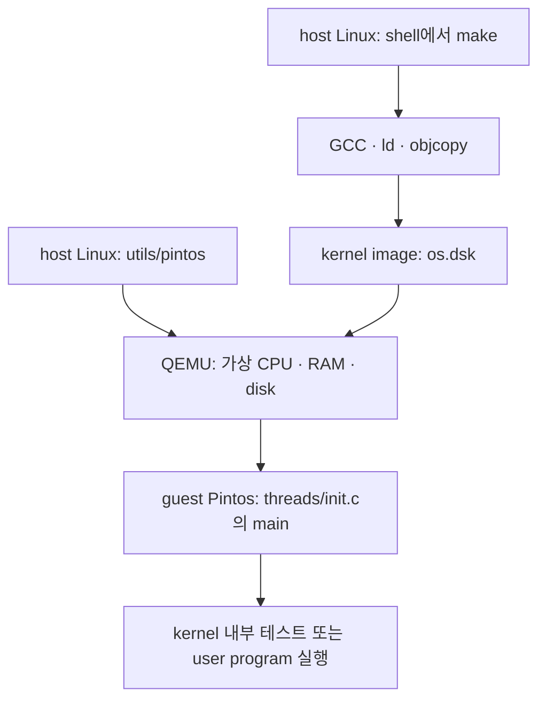

# 코드에서 길 찾기

[온보딩 목차](README.md) · 이전: [첫 빌드와 실행](01-first-run.md) · 다음: [Project 1](03-project1.md)

## host와 guest를 먼저 나눈다

`make`, `pintos`, QEMU는 SSH로 접속한 Linux에서 실행한다. 이 Linux가 **host**다. QEMU가 만든 가상 컴퓨터 안에서 돌아가는 OS가 **guest**인 Pintos다.



이 차이를 알면 오류를 구분하기 쉽다. `pintos: command not found`는 host의 명령 검색 문제다. `Kernel PANIC`은 guest kernel이 실행 중 문제를 발견한 것이다.

## 소스 directory 지도

| directory | 핵심 역할 | 처음 읽는 시점 |
| --- | --- | --- |
| `threads/` | 부팅 이후 초기화, thread, scheduler, synchronization | 지금 |
| `devices/` | timer, interrupt와 연결되는 입출력 장치 | 우선 `timer.c` |
| `include/threads/` | `struct thread`와 관련 함수 선언 | thread 코드를 읽을 때 함께 |
| `lib/kernel/`, `include/lib/kernel/` | list, hash, bitmap 등의 자료구조 | 해당 자료구조가 필요할 때 |
| `userprog/` | executable loading, process, system call, exception | Project 2 |
| `vm/`, `include/vm/` | page·frame, fault, anonymous/file-backed page | Project 3 |
| `filesys/`, `include/filesys/` | inode, 파일, directory, FAT, cache | Project 2에서는 사용법, Project 4에서는 내부 구현 |
| `lib/user/`, `include/lib/user/` | Pintos user program용 C library와 system call wrapper | Project 2 |
| `tests/` | 구현할 동작을 확인하는 테스트와 판정 규칙 | 처음부터 |
| `utils/` | host에서 QEMU를 실행하는 보조 도구 | 실행이 안 될 때 |
| 각 프로젝트의 `build/` | compiler와 테스트가 만든 결과물 | 소스를 고치는 곳이 아니라 결과를 보는 곳 |

header는 주로 `include/`에 있다. 예를 들어 `threads/thread.c`를 이해하려면 `include/threads/thread.h`를 함께 연다.

## 첫 번째 호출 흐름: 부팅 후 테스트 실행

Project 1의 간략한 실행 경로는 다음과 같다.

```text
utils/pintos가 QEMU 실행
  → threads/loader.S 등에서 CPU와 kernel 실행 준비
  → threads/init.c: main()
      → thread_init()
      → memory allocator 및 interrupt 초기화
      → timer_init()
      → thread_start()
      → Boot complete.
      → run_actions()
          → run_task()
              → tests/threads/tests.c: run_test()
                  → 선택한 테스트 함수
```

처음에는 [threads/init.c](../threads/init.c)의 `main()`, `run_actions()`, `run_task()`만 찾아본다. 초기화 함수의 모든 세부사항을 이해하려 하지 말고, 어디서 테스트로 넘어가는지 확인한다.

`userprog`·`vm`·`filesys` 구성에서는 보통 `run_task()`가 `process_create_initd()`와 `process_wait()`를 통해 user program을 실행한다. Project 1의 kernel 내부 테스트와 Project 2 이후의 user program 테스트는 시작 경로가 다르다.

## 두 번째 호출 흐름: timer interrupt

```text
가상 timer 장치가 interrupt 발생
  → 등록된 timer_interrupt()
      → ticks 증가
      → thread_tick()
      → interrupt 반환 경로에서 필요하면 다음 thread로 전환
```

관련 파일은 [devices/timer.c](../devices/timer.c), [threads/interrupt.c](../threads/interrupt.c), [threads/thread.c](../threads/thread.c)다.

`timer_interrupt()`는 다른 thread의 평범한 함수 호출과 다른 **interrupt context**에서 실행한다. handler 안에서 기다리거나 lock을 얻기 위해 sleep할 수 없다. Alarm Clock을 구현할 때 이 차이가 중요해진다.

## 세 번째 호출 흐름: thread가 기다렸다가 다시 실행

```text
실행 중인 thread
  → 더 진행할 수 없어 thread_block()
  → scheduler가 다른 ready thread 선택
  → 나중에 다른 코드가 thread_unblock(기다리던 thread)
  → ready 상태로 이동
  → scheduler가 선택하면 원래 실행 흐름 재개
```

**ready가 되었다는 것과 즉시 running이 되었다는 것은 다르다.** baseline의 `thread_unblock()`는 ready list에 넣는 역할을 하며 직접 현재 thread를 preempt하지 않는다. priority scheduling 단계에서는 언제 preemption이 필요한지 별도로 판단해야 한다.

## 실제로 처음 열 파일 5개

이 순서대로 읽으면 Alarm Clock의 시작점을 찾을 수 있다.

1. [tests/threads/alarm-wait.c](../tests/threads/alarm-wait.c): `test_alarm_single()`에서 무엇을 검증하는지 본다.
2. [devices/timer.c](../devices/timer.c): `timer_sleep()`, `timer_interrupt()`, `timer_ticks()`를 찾는다.
3. [threads/thread.c](../threads/thread.c): `thread_yield()`, `thread_block()`, `thread_unblock()`를 읽는다.
4. [include/threads/thread.h](../include/threads/thread.h): `struct thread`, 상태값, `elem` member를 읽는다.
5. [include/lib/kernel/list.h](../include/lib/kernel/list.h): list에 원소를 넣고 빼는 함수와 `list_entry()`를 읽는다.

assembly로 된 `thread_launch()`나 page table의 bit 배치를 먼저 모두 이해할 필요는 없다. 현재 바꿀 함수와 그 함수가 사용하는 상태부터 좁혀 읽는다.

## 읽으면서 기록할 네 가지

함수를 하나 읽을 때 다음 질문을 메모한다.

| 질문 | Alarm Clock에서의 예 |
| --- | --- |
| 누가 호출하나? | 기다리려는 thread가 `timer_sleep()`를 호출한다 |
| 어떤 상태를 읽고 쓰나? | 현재 tick, 깨어날 tick, thread 상태, sleep 목록 |
| 누가 동시에 접근하나? | 현재 thread와 timer interrupt handler |
| 무엇이 끝나면 다시 진행하나? | 목표 tick에 도달해 unblock되고, scheduler가 선택한다 |

이렇게 읽으면 단순히 함수 이름을 외우는 대신, 변경할 자료구조와 보호할 구간을 찾게 된다.
