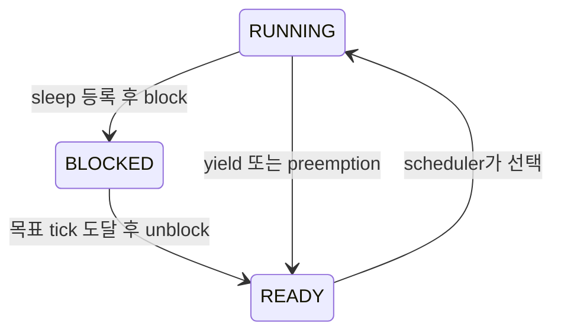

# Project 1: 첫 수정은 Alarm Clock부터

[온보딩 목차](README.md) · 이전: [코드에서 길 찾기](02-code-tour.md) · 다음: [Project 2](04-project2.md)

## 이번 단계에서 배우는 것

Project 1은 "어떤 thread를 언제 실행할 것인가"를 다룬다. baseline에는 thread를 만들고 전환하는 기능이 있다. 여기에 **기다리는 방법과 실행 순서를 정하는 정책**을 추가한다.

처음에는 다음 순서가 이해하기 쉽다.

```text
Alarm Clock
  → Priority Scheduling
  → 높은 priority가 준비됐을 때의 preemption
  → semaphore / condition variable의 waiter 선택
  → Priority Donation
  → MLFQS
```

이 순서는 이 저장소의 단계별 브랜치 구성과도 연결된다. 공식 요구사항은 [Project 1 번역본](../docs/project1/introduction.md)에서 확인한다.

## 1. Alarm Clock: 반복 확인 대신 실제로 기다리게 한다

### 먼저 읽을 코드

| 파일·함수 | baseline의 역할 | 생각할 변경 |
| --- | --- | --- |
| [devices/timer.c](../devices/timer.c)의 `timer_sleep()` | tick이 지날 때까지 yield를 반복 | 깨어날 시각을 기록하고 blocked로 전환 |
| 같은 파일의 `timer_interrupt()` | tick 증가, `thread_tick()` 호출 | 시간이 된 thread를 찾아 unblock |
| [threads/thread.c](../threads/thread.c)의 `thread_block()`·`thread_unblock()` | thread의 blocked/ready 전환 | 제공된 기능을 활용 |
| [include/threads/thread.h](../include/threads/thread.h)의 `struct thread` | thread 상태와 list element 저장 | sleep 관리에 필요한 정보 설계 |
| [tests/threads/alarm-wait.c](../tests/threads/alarm-wait.c) | 여러 thread의 wake-up 순서를 검사 | 호출과 예상 결과를 먼저 읽기 |

함수를 수정하기 전에, 종이에 다음 예를 써 본다.

```text
현재 tick = 100
A가 20 ticks sleep 요청 → 목표 tick 120
B가 5 ticks sleep 요청  → 목표 tick 105

tick 105: B를 ready로 전환
단, B가 running이 되는 시점은 scheduler가 선택하는 시점
```

### 스스로 답해야 할 설계 질문

1. 깨어날 tick을 어디에 저장할 것인가?
2. 잠든 thread들을 어떤 list에 보관할 것인가?
3. sleep 목록에 넣기와 block 사이에 timer interrupt가 오면 어떻게 되는가?
4. 같은 tick에 여러 thread가 깨어나야 하면 모두 처리하는가?
5. 0 또는 음수 시간의 요청은 어떻게 처리하는가?

핵심은 sleep 목록 등록과 block 사이의 race를 막는 것이다. thread가 목록에만 들어간 상태에서 handler가 먼저 깨워 버리거나, 등록도 되기 전에 잠들어 wake-up을 놓치면 문제가 된다. Pintos의 단일 CPU와 interrupt 비활성화 방식에 맞게 짧은 구간을 보호해야 한다.

### thread 상태로 보면 더 쉽다



잠든 thread가 ready list에서 시간을 반복 확인하지 않아야 한다. timer handler에서는 thread를 깨우기 위해 다른 thread를 기다리는 작업을 하지 않는다.

`struct thread`의 기존 `elem`을 여러 list에 동시에 넣지 않도록 주의한다. 하나의 list element는 한 시점에 하나의 list에만 연결할 수 있다. sleep 상태와 ready 상태 전환까지 포함해 element의 소유 관계를 설계한다.

### 첫 검증

저장소 루트에서 실행한다.

```bash
source ./activate
make -C threads -j2
make -C threads/build TIMEOUT=60 \
  tests/threads/alarm-single.result \
  tests/threads/alarm-multiple.result \
  tests/threads/alarm-simultaneous.result \
  tests/threads/alarm-zero.result \
  tests/threads/alarm-negative.result
```

`alarm-priority`는 wake-up 후 실행 순서에 priority scheduling도 필요하므로, Alarm Clock만 구현한 단계의 실패 원인을 따로 살펴본다. 기본 alarm 테스트가 통과하더라도 busy waiting이 제거됐는지 직접 확인한다.

이 저장소의 예제 변화는 다음 명령으로 볼 수 있다.

```bash
git diff skeleton..project1/alarm_clock -- \
  devices/timer.c threads/thread.c include/threads/thread.h
```

먼저 자신의 설계를 세운 뒤 차이를 읽으면, 추가된 member와 helper가 왜 필요한지 이해하기 쉽다.

## 2. Priority Scheduling: 숫자를 실제 실행 순서에 반영한다

priority는 숫자가 클수록 높다. ready thread 중 가장 높은 priority를 선택해야 하며, 같은 priority끼리는 FIFO 순서를 유지한다.

시작 지점은 `next_thread_to_run()`, ready list를 바꾸는 코드, `thread_set_priority()`다. 실행 중인 thread보다 높은 priority가 ready가 되었으면 적절한 경로에서 즉시 CPU를 양보해야 한다. interrupt context에서는 일반 thread와 같은 방식으로 yield할 수 없다는 점도 고려한다.

처음에는 다음 세 상황을 따로 확인한다.

| 상황 | 확인할 동작 |
| --- | --- |
| 높은 priority의 thread 생성 | 생성한 thread보다 먼저 실행할 필요가 있는가? |
| 현재 thread가 priority를 낮춤 | 다른 ready thread가 실행되어야 하는가? |
| 잠든 thread를 깨움 | 새 ready thread 때문에 preemption이 필요한가? |

관련 테스트는 `priority-fifo`, `priority-change`, `priority-preempt`다. baseline의 `priority-preempt` 실패는 priority 구현이 필요한 구체적인 예다.

## 3. Semaphore와 condition variable에도 priority를 적용한다

baseline의 [threads/synch.c](../threads/synch.c)는 waiter를 list 순서로 깨운다. priority scheduling 단계에서는 현재 effective priority가 가장 높은 waiter를 선택해야 한다.

대기 중에도 priority donation으로 priority가 변할 수 있다. list에 들어간 순간의 숫자만 믿으면 나중에 잘못된 thread를 깨울 수 있다. `sema_up()`과 `cond_signal()`에서 어떤 상태를 기준으로 선택할지 생각한다.

관련 테스트는 `priority-sema`, `priority-condvar`다. condition variable의 waiter는 내부적으로 semaphore를 사용하므로 두 계층의 관계도 읽어 본다.

## 4. Priority Donation: lock을 가진 낮은 priority의 thread를 도와준다

```text
H: 높은 priority, L이 가진 lock을 기다림
M: 중간 priority, 실행 가능
L: 낮은 priority, lock을 해제하려면 먼저 실행되어야 함
```

M만 계속 실행하면 H도 진행하지 못한다. 이를 완화하기 위해 H의 priority를 L에 전달한다. lock 해제 후에는 그 lock 때문에 받은 donation을 정리한다.

한 thread가 여러 lock을 보유하거나 donation이 여러 단계 이어지는 경우도 고려한다. base priority와 donation을 반영한 effective priority를 구분하면 상태를 설명하기 쉬워진다. 관련 파일은 `threads/synch.c`, `threads/thread.c`, `include/threads/thread.h`다.

검증은 `priority-donate-one`에서 시작해 multiple, nest, chain 등의 테스트로 넓힌다. **donation 자체는 lock에 구현하지만, 높은 priority의 waiter를 먼저 깨우는 규칙은 semaphore와 condition variable에도 필요하다.**

## 5. MLFQS: priority를 직접 계산한다

MLFQS는 별도의 scheduling 방식이다. `nice`, `recent_cpu`, `load_avg`로 priority를 계산하며 priority donation을 사용하지 않는다.

먼저 priority scheduler를 안정시킨 뒤 진행한다. 계산식, 갱신 주기, fixed-point arithmetic은 [Advanced Scheduler](../docs/project1/advanced_scheduler.md)를 읽는다. 테스트 recipe는 필요한 `-mlfqs` 옵션을 설정하므로 처음에는 make target을 이용하면 편하다.

```bash
make -C threads/build TIMEOUT=120 tests/threads/mlfqs-load-1.result
```

## 다음 프로젝트로 가기 전

`threads/build`에서 `make check`를 실행하고 실패를 확인한다. 제공 테스트 외에도 busy waiting 제거, interrupt 보호 구간, list element의 소속, donation 해제 후 상태를 설명할 수 있어야 한다.

Alarm Clock, priority 관련 기능과 MLFQS까지 마쳤다면 Project 2로 진행한다. 각 테스트의 PASS는 해당 관찰 결과를 검증한 것이므로, 구현의 상태 관리도 함께 검토한다.
